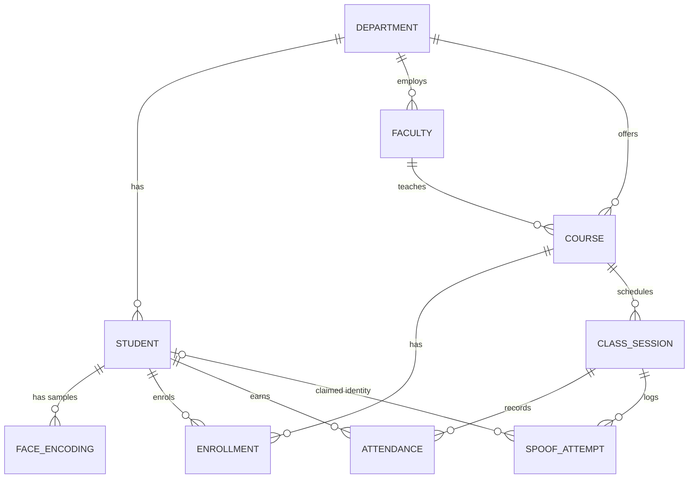

# Attendance using Face Recognition & Anti-Spoofing
DBMS semester project - Python, OpenCV, `face_recognition` (dlib), SQLite.

A student walks up to the webcam → the system recognises the face → asks for a **random liveness challenge**
(blink twice / turn head left / turn head right) → only then inserts the attendance row.
Photos, phone screens and replayed videos fail the challenge and are written to an audit table.

## 1. Setup
```bash
pip install -r requirements.txt
python seed.py                      # demo departments, courses, 8 students, 8 past sessions each
python -m unittest -v               # 14 tests, no camera needed
```
Register faces (webcam or photo folder), then take attendance:
```bash
python register_student.py --roll 21CS001 --name "Aarav Sharma" --dept "Computer Science" --semester 5
python register_student.py --roll 21CS002 --name "Diya Patel" --dept "Computer Science" --semester 5 --images ./photos/diya
python take_attendance.py --course CS301
python reports.py summary | defaulters | sessions | session 3 | spoofs | export out.csv
sqlite3 attendance.db < queries.sql       # 12 demo queries
```
`seed.py` creates students *without* faces; re-register the same roll numbers to attach your real faces
(`register_student.py` adds samples to an existing roll), or register your own friends fresh.

## 2. Files
| File | Purpose |
|---|---|
| `schema.sql` | 9 tables, constraints, indexes, 3 triggers, 3 views |
| `db.py` | all SQL access (connection, enrol, sessions, attendance, spoof log) |
| `liveness.py` | anti-spoofing: blink (EAR), head-turn (yaw), texture score |
| `register_student.py` | enrol student + store 128-d face encodings as BLOBs |
| `take_attendance.py` | live recognition → challenge → mark attendance |
| `reports.py`, `queries.sql` | reports and demo queries |
| `seed.py`, `test_project.py` | sample data, unit tests |

## 3. ER diagram

Paste into https://mermaid.live to export an image for your report.

## 4. Database design points 
**Normalisation (3NF).** Department name lives only in `department`; course/faculty details only in `course`/`faculty`;
the student–course M:N relationship is resolved by `enrollment` with a composite PK. Face samples are a separate 1:N table
instead of repeating-group columns (1NF). No non-key attribute depends on another non-key attribute (3NF).

**Integrity constraints.** PK/FK with `ON DELETE CASCADE/RESTRICT/SET NULL`, `UNIQUE(session_id, student_id)` (no duplicate
attendance), `UNIQUE(course_id, session_date, start_time)`, `CHECK` on status / semester / reason / encoding length (1024 bytes = 128 × float64).

**Triggers**
- `trg_attendance_enrolled` - rejects attendance for a student not enrolled in the course
- `trg_attendance_session_open` - rejects attendance unless the session is `Open`
- `trg_attendance_late` - marks `Late` automatically if more than 10 minutes after start

**Views.** `v_attendance_summary` (percentage per student per course), `v_defaulters` (< 75%), `v_session_report`.

**Other concepts you can point to:** correlated subqueries (`NOT EXISTS`), window function (`RANK() OVER`), `GROUP BY/HAVING`,
`LEFT JOIN`, indexes, transactions (`BEGIN/ROLLBACK` in `queries.sql`), BLOB storage of biometric data.

## 5. How the anti-spoofing works
| Layer | What it stops |
|---|---|
| **Random challenge** (blink ×2 / turn left / turn right), picked *after* recognition | Printed photo, still image on a phone, pre-recorded video |
| **Identity lock** - face re-verified every 5 frames during the challenge | Showing a photo, then swapping in a different live person |
| **Texture score** (variance of Laplacian on the face crop) | Very blurry / flat reproductions (supplementary only) |
| **Audit log** `spoof_attempt` with reason code | Gives the admin evidence; queryable (`reports.py spoofs`) |

*Blink detection:* Eye Aspect Ratio `EAR = (‖p2−p6‖ + ‖p3−p5‖) / (2‖p1−p4‖)`; EAR < 0.21 for ≥ 2 frames then open = one blink.
*Head turn:* `(nose_tip.x − jaw_left.x) / (jaw_right.x − jaw_left.x)` - 0.5 is straight; a turn is accepted only after a centred frame was seen.

**Honest limitations (say these in your viva - it shows maturity):** this defends against 2D attacks (photos, screens, replay).
A determined attacker with a 3D mask or a real-time deepfake could still beat it; industrial systems add depth/IR cameras or
trained PAD models (e.g. Silent-Face-Anti-Spoofing). The texture threshold (`TEXTURE_MIN` in `liveness.py`) depends on your
camera, so tune it or use `--no-texture`. Good lighting matters for recognition accuracy.


